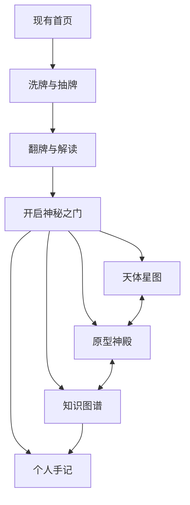
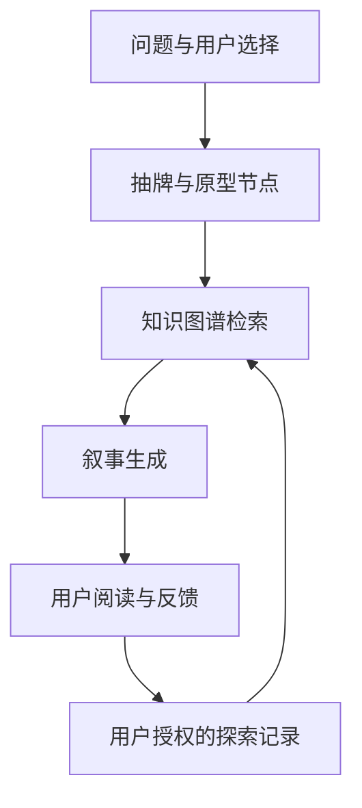

# 奶蛙塔罗 · 象征宇宙设计文档

> NAIWA ARCANA — 宇宙是地图，原型是地标，塔罗牌是入口，知识是道路，奶蛙是旅行者。

- 版本：v0.1
- 类型：产品设计 / 世界观 / 技术实现草案
- 现有项目：[Naiwa Gothic Tarot](https://dodio12138.github.io/naiwa-gothic-tarot/)
- 状态：扩展方案，尚未修改现有代码；原型映射为原创设计，传统对应须在正式发布前校核来源。

## 1. 产品定位

在保留现有哥特塔罗抽牌体验的基础上，构建以78张塔罗牌为入口、人格原型为语义核心、宇宙为视觉空间的跨学科知识探索系统。奶蛙不是预言者，而是保持平静的观察者与旅行者。

设计目标：

- 保留奶蛙IP、哥特美术、洗牌、抽牌、翻牌及仪式感。
- 让每张牌具备独立原型、心理动力、象征体系和知识网络。
- 将抽牌结果转化为可以继续探索的知识入口。
- 区分历史传统、科学事实、创作类比和用户主观解释；不宣称占卜具有科学预测能力。
- 第一阶段兼容 GitHub Pages 静态部署，不依赖 AI 或后端。

## 2. 世界观与视觉规范

核心视觉：哥特教堂玫瑰窗、中世纪浑天仪、古典星图、炼金术手稿、烛光与暗金线条。避免以现代科幻界面替代原有哥特语言。

| 元素 | 设计建议 |
|---|---|
| 背景 | 墨黑、深褐、低亮度星空 |
| 主色 | 古金、羊皮纸、奶蛙黄色 |
| 强调色 | 暗红、月光银、深蓝 |
| 字体 | 英文古典衬线、中文可读衬线；正文保证辨识度 |
| 动效 | 缓慢星轨、烛火、光线延展、镜头穿越 |
| IP | 奶蛙基础形态与表情不变，道具、服饰、环境随牌面原型变化 |

建议色值（可按现有站点调整）：`#100E10` 背景、`#B69A66` 古金、`#DFC89D` 标题、`#D9B743` 奶蛙黄、`#753644` 阴影。

## 3. 信息架构

| 场景 | 英文 | 功能 |
|---|---|---|
| 神谕祭坛 | Oracle | 保留原有占卜、洗牌和翻牌 |
| 天体星图 | Cosmos | 黄道、七曜、元素、塔罗对应 |
| 原型神殿 | Archetypes | 每张牌的原型、动力与不同表达 |
| 禁忌图书馆 | Archive | 跨学科知识图谱与概念导航 |
| 命运手记 | Chronicle | 用户主动保存的个人探索记录 |



保留直接进入各探索场景的入口；不强迫用户抽牌后才能使用知识库。

## 4. 塔罗与宇宙的传统对应

采用黄金黎明（Golden Dawn）体系作为初始传统骨架，编号采用韦特系（力量VIII、正义XI）。不同流派存在差异。以下七曜、黄道及元素是占星象征分类，不等同于现代天文学的天体分类；世界亦有土元素相关传统解释，此处采用土星作为主要映射。

### 4.1 大阿卡纳：天体、原型与表达

以下原型名称、光明面、阴影面和心理动力是奶蛙项目的原创语义设计，不是荣格提出的标准塔罗对应表。

| 编号 | 牌名 | 原型（英文） | 传统对应 | 核心动力 | 光明面 | 阴影面 |
|---|---|---|---|---|---|---|
| 0 | 愚者 | 旅人 The Wanderer | 风 | 探索未知 | 自由、开放 | 鲁莽、逃避 |
| I | 魔术师 | 创造者 The Creator | 水星 | 将可能变为现实 | 技巧、创造 | 操纵、欺骗 |
| II | 女祭司 | 守秘者 The Mystic | 月亮 | 理解隐藏事物 | 直觉、洞察 | 封闭、神秘化 |
| III | 女皇 | 母亲 The Mother | 金星 | 滋养生命 | 包容、丰饶 | 溺爱、占有 |
| IV | 皇帝 | 统治者 The Ruler | 白羊 | 建立秩序 | 责任、稳定 | 专制、控制 |
| V | 教皇 | 导师 The Mentor | 金牛 | 传承意义 | 教育、信念 | 教条、盲从 |
| VI | 恋人 | 爱人 The Lover | 双子 | 建立联结并选择 | 亲密、承诺 | 依附、沉溺 |
| VII | 战车 | 征服者 The Conqueror | 巨蟹 | 推进行动 | 意志、方向 | 支配、冒进 |
| VIII | 力量 | 驯兽者 The Tamer | 狮子 | 协调本能与意志 | 勇气、自制 | 压抑、强迫 |
| IX | 隐士 | 智者 The Sage | 处女 | 寻求理解 | 智慧、反思 | 孤立、傲慢 |
| X | 命运之轮 | 命运编织者 The Weaver | 木星 | 理解变化 | 适应、灵活 | 宿命、投机 |
| XI | 正义 | 裁决者 The Judge | 天秤 | 建立公平 | 公正、责任 | 苛刻、僵化 |
| XII | 倒吊人 | 牺牲者 The Sacrifice | 水 | 转换视角 | 接纳、超越 | 自我消耗、停滞 |
| XIII | 死神 | 转化者 The Transformer | 天蝎 | 结束并更新 | 放下、转化 | 毁灭、抗拒改变 |
| XIV | 节制 | 炼金术士 The Alchemist | 射手 | 协调不同力量 | 平衡、整合 | 过度妥协 |
| XV | 恶魔 | 诱惑者 The Tempter | 摩羯 | 满足欲望 | 本能觉察 | 成瘾、束缚 |
| XVI | 高塔 | 破坏者 The Destroyer | 火星 | 打破旧结构 | 解构、解放 | 混乱、失控 |
| XVII | 星星 | 梦想家 The Dreamer | 水瓶 | 寻找希望 | 理想、信心 | 幻想、逃避 |
| XVIII | 月亮 | 潜行者 The Shadow | 双鱼 | 面对未知 | 想象、觉察 | 恐惧、幻觉 |
| XIX | 太阳 | 神圣孩童 The Divine Child | 太阳 | 真实地表达生命 | 活力、坦诚 | 自负、幼稚 |
| XX | 审判 | 觉醒者 The Awakened | 火 | 重新理解自身 | 反思、更新 | 自责、自我否定 |
| XXI | 世界 | 整合者 The Integrated Self | 土星 | 达成整体性 | 完整、统一 | 僵化、完美主义 |

### 4.2 小阿卡纳：四种元素

| 花色 | 元素 | 黄道三宫 | 行为领域 |
|---|---|---|---|
| 权杖 | 火 | 白羊、狮子、射手 | 意志、行动、创造 |
| 圣杯 | 水 | 巨蟹、天蝎、双鱼 | 情感、关系、体验 |
| 宝剑 | 风 | 双子、天秤、水瓶 | 理性、语言、冲突 |
| 星币 | 土 | 金牛、处女、摩羯 | 劳动、资源、实践 |

黄道360°分为36个10°区间（Decans），对应四花色的2至10，共36张牌。王牌对应元素根源；宫廷牌的具体占星对应因体系与牌名转换而异，暂不强行统一。

### 4.3 36张数字牌的黄道区间

每格按该星座的第一、第二、第三个10°区间排列；括号内为传统行星主宰。此处采用黄金黎明常见对应，正式入库时需逐项核对版本。

| 星座 | 0–10° | 10–20° | 20–30° |
|---|---|---|---|
| 白羊 | 权杖2（火星） | 权杖3（太阳） | 权杖4（金星） |
| 金牛 | 星币5（水星） | 星币6（月亮） | 星币7（土星） |
| 双子 | 宝剑8（木星） | 宝剑9（火星） | 宝剑10（太阳） |
| 巨蟹 | 圣杯2（金星） | 圣杯3（水星） | 圣杯4（月亮） |
| 狮子 | 权杖5（土星） | 权杖6（木星） | 权杖7（火星） |
| 处女 | 星币8（太阳） | 星币9（金星） | 星币10（水星） |
| 天秤 | 宝剑2（月亮） | 宝剑3（土星） | 宝剑4（木星） |
| 天蝎 | 圣杯5（火星） | 圣杯6（太阳） | 圣杯7（金星） |
| 射手 | 权杖8（水星） | 权杖9（月亮） | 权杖10（土星） |
| 摩羯 | 星币2（木星） | 星币3（火星） | 星币4（太阳） |
| 水瓶 | 宝剑5（金星） | 宝剑6（水星） | 宝剑7（月亮） |
| 双鱼 | 圣杯8（土星） | 圣杯9（木星） | 圣杯10（火星） |

## 5. 56张小阿卡纳原创原型

### 5.1 40张数字牌

每个单元格代表一张牌的行为原型；数字阶段是设计辅助分类，不表示严格的人格成长顺序。

| 数字阶段 | 权杖 | 圣杯 | 宝剑 | 星币 |
|---|---|---|---|---|
| Ace 起源 | 创始者 | 感受者 | 洞察者 | 播种者 |
| 2 二元 | 规划者 | 联结者 | 犹豫者 | 协调者 |
| 3 发展 | 开拓者 | 庆祝者 | 心碎者 | 工匠 |
| 4 稳定 | 建设者 | 沉思者 | 休憩者 | 守财者 |
| 5 冲突 | 竞争者 | 失落者 | 争胜者 | 流亡者 |
| 6 调和 | 胜利者 | 怀旧者 | 渡行者 | 施予者 |
| 7 考验 | 捍卫者 | 幻想者 | 策略家 | 耕耘者 |
| 8 变化 | 奔赴者 | 离去者 | 受困者 | 学徒 |
| 9 积累 | 守卫者 | 满足者 | 忧虑者 | 自足者 |
| 10 极限 | 负重者 | 归属者 | 崩溃者 | 继承者 |

### 5.2 16张宫廷牌

| 阶段 | 权杖 | 圣杯 | 宝剑 | 星币 |
|---|---|---|---|---|
| 侍从：探索 | 冒险家 | 诗人 | 调查者 | 求学者 |
| 骑士：行动 | 先锋 | 浪漫主义者 | 辩论者 | 实干家 |
| 王后：内化 | 激励者 | 共情者 | 洞察者 | 滋养者 |
| 国王：掌控 | 领袖 | 调停者 | 战略家 | 管理者 |

上述名称允许概念重叠，例如宝剑王牌与宝剑王后都可关联洞察者，但卡牌ID必须唯一，原型节点可复用。小阿卡纳的逐牌心理动力、光影面、视觉细节与知识边仍需编辑补全。

## 6. 原型动力学

不将用户固定为某种人格。原型代表处境中的行为或叙事模式，而非临床诊断。正逆位独立于光影面；逆位可以表示不足、过度、受阻或内化，不自动等于坏。

以魔术师为例：

| 表达状态 | 表现 |
|---|---|
| 不足 | 被动、无力、难以将想法付诸实践 |
| 适度 | 运用知识与工具创造可能性 |
| 过度 | 操纵、支配、过度控制 |
| 受阻 | 具备能力但缺少资源、条件或机会 |

可提供一个交互滑杆用于探索上述表达，不将其作为测量用户心理的量表，也不以抽牌结果推断真实人格。

## 7. 跨学科知识图谱

### 7.1 知识领域

| 领域 | 内容 |
|---|---|
| Astral 天体 | 天文学事实、占星传统、黄道、行星 |
| Mythos 神话 | 神祇、英雄、文学人物、神话母题 |
| Psyche 意识 | 心理概念、情绪、原型、认知 |
| Logos 理性 | 哲学、伦理、社会理论 |
| Genesis 规律 | 物理、控制论、复杂系统、数学 |
| Symbol 符号 | 牌面道具、图像、颜色、纹样 |

### 7.2 大阿卡纳的知识节点候选

以下是编辑候选类比，并非历史上的固定对应，也不主张神话人物、哲学与科学概念彼此等价。

| 塔罗 | 神话/文学母题 | 哲学/心理主题 | 科学或系统隐喻 | 美术道具 |
|---|---|---|---|---|
| 愚者 | 英雄启程 | 自由、开放性 | 随机探索 | 行囊、悬崖 |
| 魔术师 | 普罗米修斯 | 能动性 | 工具使用、系统输入 | 四元素器具 |
| 女祭司 | 神谕、秘仪 | 内省、未知 | 隐状态 | 帷幕、书卷 |
| 女皇 | 得墨忒耳 | 关怀 | 生长、生态系统 | 麦穗、花园 |
| 皇帝 | 宙斯的统治 | 权威、秩序 | 层级控制 | 王座、权杖 |
| 教皇 | 导师传承 | 制度、传统 | 规则传播 | 钥匙、经卷 |
| 恋人 | 厄洛斯与普赛克 | 选择、亲密 | 多目标权衡 | 双人、天使 |
| 战车 | 赫利俄斯战车 | 意志 | 轨迹控制 | 战车、缰绳 |
| 力量 | 赫拉克勒斯与狮子 | 自制、勇气 | 约束控制 | 狮子、花环 |
| 隐士 | 奥丁求智 | 认识自我 | 观测与信息获取 | 提灯、山路 |
| 命运之轮 | 命运三女神 | 偶然、决定论 | 周期系统 | 转轮 |
| 正义 | 忒弥斯 | 公平、责任 | 约束与优化 | 天平、剑 |
| 倒吊人 | 奥丁悬树 | 牺牲、换位 | 参考系转换 | 倒悬、树 |
| 死神 | 凤凰重生 | 终结与更新 | 相变 | 镰刀、落日 |
| 节制 | 伊里斯 | 中庸、自我调节 | 负反馈 | 双杯、水流 |
| 恶魔 | 浮士德契约 | 欲望、异化 | 路径依赖 | 锁链、契约 |
| 高塔 | 巴别塔 | 辩证否定 | 系统失稳 | 雷电、坍塌 |
| 星星 | 希望母题 | 理想、恢复 | 目标状态 | 星辰、水罐 |
| 月亮 | 迷宫母题 | 怀疑、恐惧 | 观测噪声 | 月、双塔 |
| 太阳 | 太阳神母题 | 生命、坦诚 | 能量输入 | 太阳、向日葵 |
| 审判 | 末日审判母题 | 反思、责任 | 状态重新评估 | 号角 |
| 世界 | 世界蛇 | 整体论、自性 | 涌现、整体性 | 花环、圆环 |

### 7.3 关系类型

| 关系 | 示例 | 类别 |
|---|---|---|
| CORRESPONDS_TO | 高塔 → 火星 | 传统对应 |
| EMBODIES | 高塔 → 破坏者 | 原创原型 |
| SYMBOLIZES | 高塔 → 结构崩溃 | 象征解释 |
| ANALOGOUS_TO | 结构崩溃 → 系统失稳 | 跨学科类比 |
| CONTRASTS_WITH | 高塔 → 稳定 | 语义对照 |
| PRECEDES | 高塔 → 星星 | 序列结构 |
| DEPICTS | 高塔 → 闪电 | 图像事实（按牌组） |
| INSPIRED_BY | 原创插画 → 某神话 | 创作来源 |
| RELATED_TO | 自我调节 → 反馈 | 领域知识关系 |

每条边记录来源、传统版本、解释理由、审核状态与关系类别。不得把原创类比呈现为科学证据。

## 8. 交互原型规格

### 8.1 天体星图

- 外环：12个黄道宫，细分36个10°区间；内环：古典七曜；中心：奶蛙。
- 元素层可切换，显示四花色与大阿卡纳元素对应。
- 点击天体、星座或区间：高亮对应卡牌、原型和主题，提供进入原型神殿的入口。
- 默认是象征性星图；真实天体位置作为可选独立视图，不混淆两者。

### 8.2 原型神殿

```text
┌──────────────────────────────────┐
│ NAIWA · THE TEMPLE OF ARCHETYPES │
│            选择塔罗牌             │
│              [天体]              │
│      [神话]           [心理]      │
│            ┌────────┐            │
│            │ 奶蛙牌面 │            │
│            │ 核心原型 │            │
│            └────────┘            │
│      [哲学]           [科学]      │
│              [符号]              │
│     光明面 / 阴影面 / 表达状态     │
│          动力与解释详情            │
└──────────────────────────────────┘
```

支持全部78张牌的检索；中心显示现有牌面资源；点击外围节点后展开详情及关联路径。所有演示图形均应替换为真实项目素材，不重新发明奶蛙形象。

### 8.3 知识星座

以选中卡牌或原型为中心，显示一阶邻居；点击节点后重新定心，可展开二阶邻居。保留返回历史、关系筛选、来源详情、搜索与缩放。节点超过一定数量时折叠为领域簇，避免图谱拥挤。

### 8.4 场景过渡

翻牌完成 → 用户主动开启探索 → 牌缘光线延展 → 背景暗化 → 光线形成星座 → 镜头进入星图 → 本次牌组成为核心节点。

动效必须可跳过，并支持 `prefers-reduced-motion`。手机端支持触摸，不依赖鼠标悬停或陀螺仪权限。

### 8.5 个人宇宙

用户主动保存的问题、牌阵、感想及探索路径形成私人节点。可按主题或时间聚类，允许编辑、导出、删除；默认本地保存，不自动上传隐私内容。不根据浏览停留时长秘密推断人格。

## 9. 数据设计

推荐先使用 JSON 与静态资源，不要求重构现有仓库。以下目录是建议结构，而非已核实的仓库布局。

```text
data/
  cards.json
  archetypes.json
  cosmos.json
  mythology.json
  psychology.json
  philosophy.json
  science.json
  symbols.json
  edges.json
  sources.json
```

### 9.1 卡牌示例

```json
{
  "id": "major_01",
  "name": "魔术师",
  "name_en": "The Magician",
  "arcana": "major",
  "number": 1,
  "archetype_id": "archetype_creator",
  "cosmos_ids": ["mercury"],
  "visual": {
    "character": "naiwa",
    "role": "alchemist",
    "objects": ["wand", "cup", "sword", "pentacle"]
  }
}
```

### 9.2 原型示例

```json
{
  "id": "archetype_creator",
  "name": "创造者",
  "name_en": "The Creator",
  "motivation": "将可能性转化为现实",
  "fear": "无力与失去控制",
  "light": ["创造", "行动", "技巧"],
  "shadow": ["操纵", "欺骗", "支配"],
  "deficiency": ["被动", "无力"],
  "excess": ["过度控制", "自负"],
  "blocked": ["资源不足", "行动受限"],
  "origin": "naiwa_original"
}
```

### 9.3 知识节点与边示例

```json
{
  "nodes": [
    {"id": "mars", "type": "astrological_body", "name": "火星"},
    {"id": "system_instability", "type": "science", "name": "系统失稳"}
  ],
  "edges": [
    {
      "source": "major_16",
      "target": "mars",
      "relation": "CORRESPONDS_TO",
      "category": "traditional",
      "tradition": "Golden Dawn",
      "source_ids": [],
      "review_status": "pending"
    },
    {
      "source": "major_16",
      "target": "system_instability",
      "relation": "ANALOGOUS_TO",
      "category": "interpretive",
      "rationale": "以既有结构失去稳定性类比牌面中的崩塌",
      "review_status": "pending"
    }
  ]
}
```

`source_ids` 为空表示尚未完成引文录入，不能在生产界面标为已核实。建立统一ID、类型枚举、JSON Schema、引用完整性校验；每张卡牌必须有原型映射，所有边必须指向存在的节点。

## 10. 技术架构

| 模块 | 首选方案 | 扩展方案 |
|---|---|---|
| 星空与天体仪 | SVG + CSS + JS | Three.js / GLSL |
| 知识图谱 | SVG / D3.js | WebGL 或图数据库 |
| 数据 | 静态 JSON | Neo4j / PostgreSQL |
| 私人记录 | IndexedDB | 用户授权的云端同步 |
| 天文数据 | 预计算星历 JSON | Skyfield + 后端或构建任务 |
| 叙事 | 人工编写模板 | LLM + GraphRAG |
| 部署 | GitHub Pages | 独立 FastAPI 服务（需要时） |

真实天文数据可参考 [JPL Horizons](https://ssd.jpl.nasa.gov/horizons/)、[Gaia Archive](https://gea.esac.esa.int/archive/)、[Skyfield](https://rhodesmill.org/skyfield/)、[NASA APIs](https://api.nasa.gov/)；知识扩展可参考 [Wikidata](https://www.wikidata.org/)。这些是候选数据入口，尚未验证接口、授权和集成成本。不要在静态前端暴露 API 密钥。

## 11. AI 与反馈系统（后期）

AI 负责从知识图谱检索有依据的节点并生成探索叙事，不预测未来。用户可以选择接受、拒绝或切换视角；反馈只更新用户主动认可的探索偏好。



输出必须区分传统解释、原创类比与实际知识；涉及医疗、法律、财务等重大决策时不以塔罗替代专业依据。

## 12. 开发路线与验收

| 版本 | 内容 | 验收标准 |
|---|---|---|
| V1 | 22张大阿卡纳、原型神殿、天体仪 | 22张均可选择并显示完整原型、光影面、传统对应 |
| V2 | 扩展78张与36个黄道区间 | 78个唯一ID、完整原型映射、36个区间无遗漏或重复 |
| V3 | 跨学科图谱 | 可重新定心、筛选关系、查看依据、返回路径 |
| V4 | 三维星图与真实天文环境 | 象征和真实天文视图明确区分，移动端可退化为二维 |
| V5 | 私人宇宙 | 可保存、编辑、导出、删除记录，默认不上传 |
| V6 | AI叙事 | 可追溯知识来源，用户可控制反馈与数据使用 |

第一阶段优先级：保留现有体验 → 原型数据 → 天体仪 → 原型神殿 → 翻牌后的探索入口。无需先实现三维渲染或 AI。

通用验收：移动端可操作、键盘可访问、动效可关闭、文字对比度充足；原有抽牌功能无回归；资源缺失有占位处理；传统与原创关系有明确标注。

## 13. 待确认事项

- 现有仓库结构、素材命名、前端框架和抽牌事件接口（尚未审查源码）。
- 采用哪个具体黄金黎明文本版本作为正式引用，以及宫廷牌的传统映射规则。
- 56张小阿卡纳的逐牌心理动力、光影面、知识边和视觉脚本。
- 用户是否需要真实天文视图、个人记录和 AI 功能，以及这些功能的优先顺序。
- 现有美术素材的使用许可及外部知识数据授权。

## 14. 核心文案

> 星辰不曾回答你的问题。它们只是照亮了你尚未看见的道路。

奶蛙不告诉你命运是什么，它陪你探索不同的可能性。
