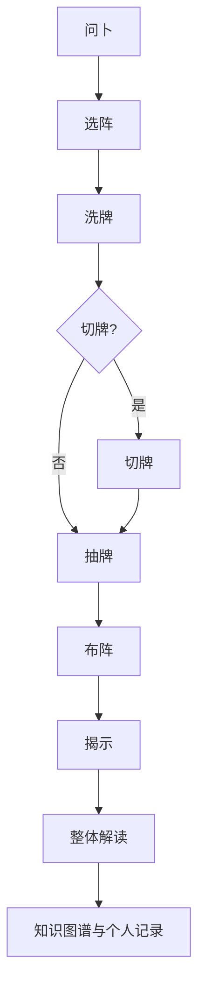
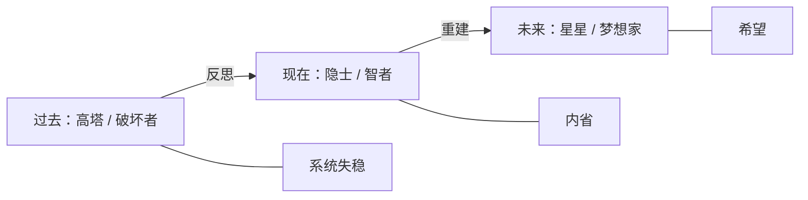

# 奶蛙塔罗 · 抽牌仪式与牌阵系统设计

> 版本：V0.1 | 独立模块设计文档 | 配合 naiwa-tarot-design.md 使用

## 1. 设计目标

保留哥特式抽牌仪式，将牌阵、正逆位、原型及知识图谱连接起来。采用韦特系78张牌作为默认牌组（22张大阿卡纳、56张小阿卡纳）。塔罗没有唯一标准流程，以下传统牌阵采用常见版本，原创牌阵单独标注。解读用于象征性叙事和自我反思，不作为科学预测。

## 2. 抽牌流程

| 阶段 | 操作 | 网页交互 |
|---|---|---|
| 1 问卜 | 明确问题，可留空 | 输入问题或选择主题 |
| 2 选阵 | 确定张数及位置语义 | 预览牌阵 |
| 3 洗牌 | 随机排列牌组 | 混合、旋转、叠放动画 |
| 4 切牌（可选） | 分割牌堆并重新合并 | 拖动牌堆 |
| 5 抽牌 | 无放回地选取指定数量 | 点击背面牌 |
| 6 布阵 | 按顺序填充牌位 | 卡牌飞入指定位置 |
| 7 揭示 | 依次或统一翻牌 | 翻牌、正逆位动画 |
| 8 解读 | 单牌、组合及整体解读 | 展示牌义与位置含义 |
| 9 探索（原创） | 进入原型与知识宇宙 | 星轨连接与镜头过渡 |



规则：牌阵须在抽牌前锁定；切牌不是必需；选择牌面之前不得向用户泄露牌的身份；翻牌不改变已经确定的抽牌结果。

## 3. 常用传统牌阵

### 3.1 单牌阵（1张）

```text
[1]
```

1. 当下指引或反思主题。

适合每日神谕和快速体验。

### 3.2 时间之流（3张）

```text
[1] [2] [3]
```

1. 过去：背景与既有影响。
2. 现在：当前状态。
3. 未来：可能的发展方向，而非必然结果。

从左至右抽取、放置及解读。建议作为默认经典牌阵。

### 3.3 十字牌阵（5张）

采用以下一种常见变体：

```text
     [4]
[2]  [1]  [3]
     [5]
```

1. 现状（中心）
2. 阻碍（左）
3. 助力（右）
4. 建议（上）
5. 可能的发展（下）

### 3.4 马蹄牌阵（7张）

```text
[1]                 [7]
   [2]           [6]
      [3]     [5]
          [4]
```

按1至7抽取：过去、现在、潜在影响、阻碍、外部环境、建议、可能结果。不同流派布局和语义存在差异，本项目固定使用此版本。

### 3.5 凯尔特十字（10张）

```text
          [5]             [10]
                          [9]
[4]    [1×2]    [6]       [8]
                          [7]
          [3]
```

| 顺序 | 位置 | 含义 |
|---|---|---|
| 1 | 中央 | 当前处境 |
| 2 | 横跨1 | 挑战 |
| 3 | 下 | 基础、潜意识 |
| 4 | 左 | 过去 |
| 5 | 上 | 意识、目标 |
| 6 | 右 | 近期发展 |
| 7 | 右列底部 | 自我与态度 |
| 8 | 7上方 | 外部环境 |
| 9 | 8上方 | 希望与恐惧 |
| 10 | 右列顶部 | 可能结果 |

采用常见现代版本。第二张横置仅表示牌阵布局，正逆位需要独立记录，不能由横置角度推断。解读应综合中心交叉、上下轴、时间轴及右侧四张牌。

### 3.6 黄道十二宫牌阵（12张）

从左侧第一宫开始，逆时针依次排列（屏幕坐标中向左下方推进）。每抽一张点亮对应宫位。

| 顺序 | 宫位主题 |
|---|---|
| 1 | 自我、人格 |
| 2 | 资源、财富、价值 |
| 3 | 交流、学习 |
| 4 | 家庭、根基 |
| 5 | 创造、恋爱、娱乐 |
| 6 | 日常、工作、健康习惯 |
| 7 | 伴侣、合作 |
| 8 | 转化、共享资源 |
| 9 | 探索、哲学、信念 |
| 10 | 事业、社会角色 |
| 11 | 社群、朋友、理想 |
| 12 | 潜意识、隐秘世界 |

宫位与黄道星座不是同一概念。可使用自然黄道符号进行视觉类比，但不能将牌阵称为真实出生星盘。

## 4. 三牌阵语义变体

| 名称 | 位置1 | 位置2 | 位置3 |
|---|---|---|---|
| 时间之流 | 过去 | 现在 | 未来 |
| 问题解析 | 现状 | 阻碍 | 建议 |
| 身心灵 | 身体 | 思想 | 精神 |
| 情感关系 | 自我 | 对方（用户视角） | 关系 |
| 自我探索 | 意识 | 潜意识 | 行动 |
| 决策探索 | 选择A | 选择B | 考虑因素 |
| 荣格原型（原创） | 人格面具 | 阴影 | 自性 |
| 系统演化（原创） | 初始状态 | 扰动 | 演化方向 |
| 宇宙神谕（原创） | 起源 | 引力 | 轨迹 |

原创荣格牌阵并非荣格提出的心理测量方法；关系牌阵不能推断他人真实想法。

## 5. 奶蛙产品模式

| 模式 | 张数 | 类型 |
|---|---:|---|
| 每日神谕 | 1 | 单牌 |
| 时间之流 | 3 | 经典 |
| 命运之镜 | 3 | 原创：人格面具、阴影、自性 |
| 灵魂共鸣 | 6 | 原创：自我需求、对方（用户视角）、共同基础、冲突、沟通、行动建议 |
| 命运岔路 | 5 | 原创：现状、A机会、A代价、B机会、B代价 |
| 凯尔特十字 | 10 | 经典 |
| 黄道神谕 | 12 | 占星主题 |
| 原型之旅 | 22 | 原创：大阿卡纳长期探索 |

原创位置定义为本设计建议，可后续调整。原型之旅建议采用22张大阿卡纳无放回的长期探索模式，或按0至21的固定叙事顺序浏览；后者不是随机占卜。

## 6. 正逆位机制

- 实体牌：通过洗牌过程中改变部分牌的朝向产生逆位。
- 数字牌：洗牌时为每张牌确定朝向；默认逆位概率50%，可配置0–100%。
- 仅正位：关闭逆位，仍可结合位置与上下文解释原型的阴影面。
- 正位不等于好，逆位不等于坏。逆位可以表示不足、过度、受阻或内在表达。
- 翻牌动画与牌阵中的旋转角度不应改变语义朝向。

## 7. 随机与状态机实现

采用 Fisher–Yates 洗牌算法；同一会话无放回抽样；牌序与朝向在洗牌时锁定。切牌只重排既有牌序。AI 不参与随机选择，不得因用户问题或解读结果替换卡牌。

```javascript
function shuffle(deck, rng, reverseProbability = 0.5) {
  const cards = deck.map(card => ({
    cardId: card.id,
    reversed: rng() < reverseProbability
  }));
  for (let i = cards.length - 1; i > 0; i--) {
    const j = Math.floor(rng() * (i + 1));
    [cards[i], cards[j]] = [cards[j], cards[i]];
  }
  return cards;
}
```

`rng` 应返回 `[0,1)` 内的均匀伪随机数；若要求种子复现，需使用明确版本的可播种PRNG，不能只保存 `Math.random()` 的所谓种子。历史回放优先保存最终结果和位置映射。

状态机：`QUESTION → SPREAD_SELECTED → SHUFFLED → CUT(optional) → DRAWING → PLACED → REVEALING → INTERPRETED → EXPLORING`。

防止重复点击、超额抽牌、重复翻牌导致重抽；刷新页面后恢复已锁定会话；允许显式创建新会话而非隐式修改结果。

## 8. 数据结构

建议独立配置 `data/spreads.json`，不将牌阵语义硬编码在卡牌数据中。

```json
{
  "id": "past_present_future",
  "name": "时间之流",
  "category": "traditional",
  "card_count": 3,
  "deck": "full_78",
  "allow_reversed": true,
  "positions": [
    {"id": "past", "order": 1, "meaning": "过去", "x": -1, "y": 0},
    {"id": "present", "order": 2, "meaning": "现在", "x": 0, "y": 0},
    {"id": "future", "order": 3, "meaning": "未来", "x": 1, "y": 0}
  ],
  "edges": [
    {"source": "past", "target": "present", "relation": "temporal_transition"},
    {"source": "present", "target": "future", "relation": "possible_development"}
  ]
}
```

会话示例：

```json
{
  "session_id": "example-session",
  "spread_id": "past_present_future",
  "question": "我如何面对变化？",
  "reverse_probability": 0.5,
  "draws": [
    {"order": 1, "position_id": "past", "card_id": "major_16", "reversed": false},
    {"order": 2, "position_id": "present", "card_id": "major_09", "reversed": false},
    {"order": 3, "position_id": "future", "card_id": "major_17", "reversed": false}
  ]
}
```

## 9. 牌阵知识图谱与解读

公共图谱保存78张牌、原型、传统天体对应和原创跨学科关系；每次抽牌生成独立的临时叙事子图。



- 卡牌：节点身份。
- 位置：语义上下文。
- 牌阵：关系拓扑。
- 正逆位：表达状态。
- 用户问题：叙事约束。
- AI：在已确定的节点与关系上生成解释。

解读顺序：先单牌及其位置，再相邻关系，再整体主题，最后提出开放式反思问题。区分传统对应、原创类比和事实知识，避免将随机抽牌解释为确定的未来。

## 10. 界面与实现路线

1. V1：单牌、三牌阵、洗牌、无放回抽样、正逆位。
2. V2：五牌十字、马蹄、凯尔特十字及响应式布局。
3. V3：十二宫天体仪、宫位点亮、原型神殿过渡。
4. V4：原创牌阵、临时知识子图、历史记录与回放。
5. V5：可选 AI 整体解读及图谱检索。

静态 GitHub Pages 可使用 JavaScript、SVG/CSS 与 IndexedDB 完成前四阶段的本地核心功能。若使用需要密钥的 AI 服务，须通过安全后端代理，不得将密钥写入公开前端。

## 11. 验收标准

- 每个牌阵的张数、位置ID和顺序唯一且一致。
- 同一会话无重复牌；0%逆位全部正位，100%逆位全部逆位。
- 横置牌与逆位语义独立。
- 洗牌后用户选择、翻牌、刷新不改变已确定的牌身份与朝向。
- 历史回放准确复现结果；支持删除私人记录。
- 手机端可完成抽牌，支持减少动画与键盘操作。
- AI 不改变抽牌结果；传统知识与原创映射有明确标识。

## 12. 范围说明

本文件是独立的产品与技术设计，不包含对现有仓库源码的审查或修改。传统牌阵采用明确的一种变体，并非唯一历史标准；原创牌阵及默认配置均为设计提案。
