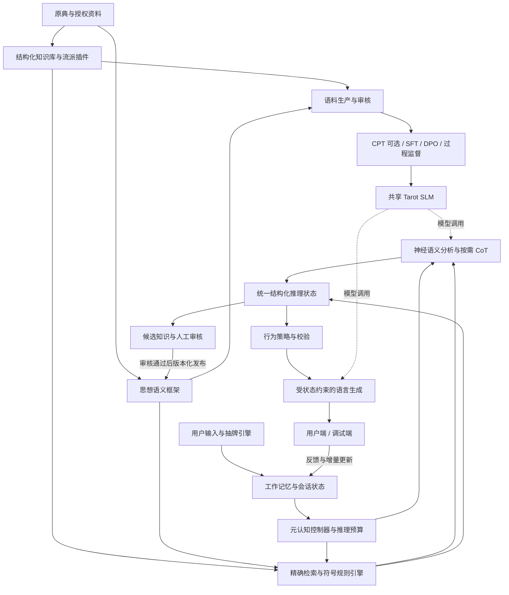
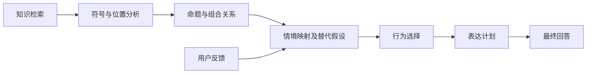
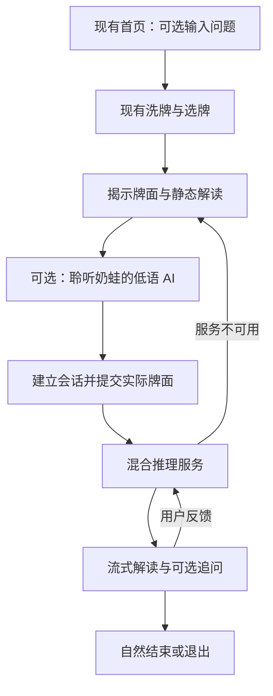
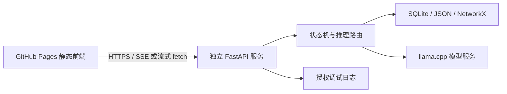

# Naiwa Gothic Tarot — 神经符号混合 AI 开发技术文档

> 技术设计文档 v0.4 | 2026-11-26 | 设计阶段，尚未实现或实测


## 0. 现有项目基线与范围

- 在线产品：https://dodio12138.github.io/naiwa-gothic-tarot/
- 源码参考：https://github.com/dodio12138/naiwa-gothic-tarot
- 基线来自公开页面及仓库 README；尚未逐文件审计、运行或修改仓库。README 部分旧描述仍写 22 张，功能说明则明确支持完整 78 张及大阿卡纳模式；实际数据条数和 ID 需在实施时校验。
- 产品名称沿用网站的「奶蛙 · 暗夜塔罗」。保留现有 Vite、GSAP、Canvas、原生 JS 及哥特美术，不重写前端。
- 用户确认取消塔罗师培训模式；保留用户交互与开发调试、过程监督、内部错误诊断。
- 产品继续支持 78 张牌；22 张大阿卡纳仅为深度语义实验优先范围，不缩减用户现有功能。

## 1. 项目目标

构建可本地部署的小语言模型及其运行时系统，以塔罗牌为外部符号约束，实现传统牌义解读、哲学命题生成、微言大意、寓言、渐进式展开、主动追问、反馈修正。系统不以预测未来或诊断心理状态为目标，而以符号一致性、思想连续性、表达质量和用户自主反思为目标。

设计原则：知识库定义知识，语义框架定义思想，训练语料定义能力，运行时定义行为。正式采用神经符号混合推理架构（Hybrid Neuro-Symbolic Reasoning），保留模型显式推理与开放性解释能力，同时由外部程序执行知识检索、确定性规则和状态维护。传统解释、现代哲学扩展、用户事实与模型假设严格分离。

## 2. 总体架构



训练端负责形成可迁移的能力；运行端负责检索、抽牌、状态维护、可控思想展开和安全边界。二者共享版本化的数据契约，但不共享未经筛选的用户隐私数据。

## 3. 数据资产分类

| 资产 | 归属 | 训练用途 | 运行时用途 |
|---|---|---|---|
| 原典、哲学著作、授权案例 | Sources | 可选 CPT 或派生 SFT | 来源追溯 |
| 牌义、图像符号、正逆位、牌阵 | Knowledge Base | 派生知识与组合任务 | 精确检索 |
| 命题、矛盾、语义种子、关系图谱 | Semantic Framework | 派生推理与表达任务 | 思想约束 |
| 追问规则、心理动力学启发框架 | Semantic Framework | 派生行为与多轮任务 | 策略参考 |
| 箴言、寓言、示范解读 | Curated Seeds | SFT、偏好样本 | 可选示例检索 |
| 虚拟用户情境与分支反馈 | Corpus | SFT/DPO | 不直接作为真实用户信息 |
| 分析轨迹与错误标注 | Corpus | 过程监督、纠错 SFT | 调试格式参考 |
| 当前抽牌、对话状态、用户反馈 | Runtime | 默认不训练 | 当前会话 |
| 专家审核案例与独立测试 | Benchmark | 不参与训练 | 离线评估 |

## 4. 知识库

### 4.1 原典与传统体系

优先使用 Rider–Waite–Smith（RWS）作为 MVP 的主要牌组；马赛与托特作为独立扩展，不混淆对应关系。原始资料记录作者、版本、章节、语言、版权许可及来源 URL。建议候选原典：A. E. Waite《The Pictorial Key to the Tarot》、Papus《The Tarot of the Bohemians》、Éliphas Lévi 的神秘学著作；哲学扩展可参考《道德经》《庄子》、赫尔墨斯文集及荣格相关著作。具体版本和使用许可须另行核验，现代译文不自动视为公版。

### 4.1.1 多体系插件与差异

| 维度 | 马赛 Tarot de Marseille | 韦特 RWS | 托特 Thoth |
|---|---|---|---|
| 基础组织 | 传统图案、数字、花色、构图 | 图像叙事、人物、象征 | 占星、元素、卡巴拉与神秘学对应 |
| 小阿卡纳 | 多为数字花牌 | 多为情境插画 | 抽象构图及对应关系 |
| 宝剑三示例 | 从三、剑与构图组合解释 | 穿心的剑与痛苦意象 | Sorrow；土星在天秤座、Binah 对应 |
| 系统侧重点 | 组合推理 | 叙事及联想 | 规则与关系推演 |

上述为工程抽象，并非各流派唯一的解释方法。马赛与托特不默认继承 RWS 的逆位规则；不同版本的编号、名称和对应须独立保存（如正义/力量的编号、托特 Lust 与 Art）。现有产品保留完整 78 张奶蛙牌；首期深度语义实验可从 RWS 的 22 张大阿卡纳开始，未增强的牌保留现有静态解读。

统一接口 `TarotTradition`：`get_card(card_id)`, `get_symbols(card_id)`, `get_correspondences(card_id)`, `interpret_orientation(card_id, orientation)`, `get_rules()`, `validate_spread(spread)`。所有返回的解释记录携带 `tradition_id`, `version`, `source_refs` 与 `interpretation_type`。跨体系比较须明确标识来源，禁止默默混用；哲学与心理动力学插件独立于塔罗流派插件。原典细节与许可在入库前核验。

### 4.2 实体及字段

- `cards`：稳定 ID、牌组、编号、花色、名称、正逆位解释、符号引用、传统对应关系、来源。
- `symbols`：图像元素、观察描述、多个可能意义、适用流派、出处；不得把推测当成图像事实。
- `spreads`：牌数、位置 ID、语义角色、布局、约束；例如现状/阻碍/建议、过去/现在/未来、关系、决策与凯尔特十字。
- `traditions` / `correspondences`：流派、元素、数字、占星等对应，允许相互冲突的传统并存。
- `sources`：文献定位、版权、审核状态及修订版本。

```json
{
  "card_id": "rws.major.15",
  "name": {"zh": "恶魔", "en": "The Devil"},
  "tradition": "RWS",
  "symbols": ["chain", "pedestal", "inverted_pentagram"],
  "upright": ["依赖", "束缚", "欲望"],
  "reversed": ["可能的解除或重新审视束缚"],
  "source_refs": [],
  "review_status": "draft"
}
```

以上为示意记录，不是已审核原典条目。78 张牌最终统一 schema；首期深度语义实验先处理 22 张大阿卡纳，不限制现有产品牌组。

## 5. 思想语义框架

### 5.1 核心模块

| 模块 | 作用 |
|---|---|
| Propositions | 每张牌多个可讨论的核心命题 |
| Contradictions | 自由/风险、秩序/压制、欲望/束缚等张力 |
| Semantic Seeds | 可压缩、展开、跨情境表达的最小思想单元 |
| Relation Graph | 对立、互补、强化、转化、否定、循环等关系 |
| Philosophy Profiles | 可切换的解释框架及适用边界 |
| Inquiry Trees | 基于符号和命题的追问路径、反馈分支与停止条件 |
| Rhetoric Profiles | 箴言、悖论、留白、寓言、意象、辩证转化 |

传统神秘主义、炼金术、赫尔墨斯体系与现代荣格心理学、存在主义、辩证法、控制论、道家等分开标记。现代扩展不得伪装成历史正统。哲学框架可由用户选择或关闭，不借助占卜权威隐蔽灌输立场。

```json
{
  "seed_id": "devil.autonomy.01",
  "card_refs": ["rws.major.15"],
  "symbol_refs": ["chain"],
  "proposition": "某些约束同时提供安全感，但外部强制也可能独立存在",
  "tensions": [["安全", "自由"]],
  "framework": "modern_dialectical_extension",
  "aphorism": "有些锁链的另一端，系着人所珍视的东西。",
  "expansion_topics": ["安全感", "现实约束", "选择条件"],
  "counterexamples": ["外部强制导致无法离开，不应归咎于当事人"],
  "source_kind": "original_interpretation",
  "review_status": "draft"
}
```

### 5.2 表达深度

L0 关键词；L1 微言；L2 意象与寓意；L3 哲学阐释；L4 情境应用。各层保持同一命题，同时允许用户要求更具体、更简短或改变解释方向。渐进展开不是故意隐藏答案或制造依赖。

### 5.3 多牌组合

图谱边必须带 `relation_type`、来源、适用条件、反例、流派及置信说明。组合不是拼接牌义，例如皇帝与恶魔可以形成秩序和束缚的张力，但不是必然关系；星星与高塔可以形成重建主题，但不是对现实事件的预测。

## 6. 心理动力学启发的反思性交互（新增）

### 6.1 理论边界

借鉴精神分析和心理动力学的探索方法，以及荣格分析心理学的象征与联想方法；两者并非同一理论体系。塔罗不具备经验证的心理诊断或预测能力。模型是非临床反思工具，不冒充治疗师，不宣称发现用户的潜意识真相。理论概念是可选的解释假设，不是用户事实。

### 6.2 方法与训练任务

| 方法 | 示例 | 约束 |
|---|---|---|
| 自由联想 | 这幅图最先让你想到什么？ | 不暗示标准答案 |
| 象征探索 | 这道门对你而言意味着什么？ | 用户定义优先 |
| 情感反映 | 你说既期待变化又担心代价。 | 仅反映已表达信息 |
| 矛盾探索 | 这两个愿望之间是否存在冲突？ | 允许不存在冲突 |
| 重复模式 | 这种情形过去是否也发生过？ | 不预设童年或创伤 |
| 多重解释 | 还有没有另一种理解？ | 保留反例与未知 |
| 关系体验 | 你希望这次对话给你什么？ | 不诱导依附或制造移情 |
| 结束与整合 | 哪个角度对你有帮助？ | 尊重拒绝和停止 |

转移/移情、反移情、防御机制等可作为内部理论参考和合成测试案例，不能依据塔罗或几轮对话认定真实用户存在相关心理机制。不得诱导回忆、暗示被压抑的创伤、强化妄想或利用脆弱性。用户可跳过任何问题；遇明显危机应退出占卜式解释并提供适当现实支持。

### 6.3 分支样本

同一月亮牌，用户 A 说想到海边：探索其个人联想；用户 B 说想到害怕：询问愿不愿谈这种感受；用户 C 说没有特别感觉：接受，不强行分析；用户 D 要求简单牌义：切回普通解读；用户 E 要结束：立即结束。不得将沉默或否定解释成所谓阻抗的证据。

### 6.4 知识与语料分离

`psychodynamic_profiles.json` 保存理论来源、概念、适用边界；`reflective_inquiry_rules.json` 保存动作与停止规则。训练语料包含自由联想、非诱导追问、用户否定、反馈修正、替代解释、结束交互和合成测试案例。默认不采集真实用户敏感心理记录用于微调。

## 7. 训练语料设计

| ID | 任务 | 格式 |
|---|---|---|
| TC01 | 原典语言与领域文本 | CPT，可选 |
| TC02 | 基础知识问答 | SFT |
| TC03 | 符号抽象 | SFT |
| TC04 | 哲学命题及矛盾分析 | SFT |
| TC05 | 微言大意与语义压缩 | SFT |
| TC06 | 寓言、隐喻与修辞 | SFT |
| TC07 | 多牌组合及牌阵位置 | SFT |
| TC08 | 情境映射及反事实 | SFT |
| TC09 | 主动追问与行为选择 | SFT |
| TC10 | 渐进式语义展开 | SFT |
| TC11 | 多轮反馈、修正、终止 | SFT |
| TC12 | 好坏回答与策略对比 | DPO |
| TC13 | 结构化分析、错误诊断 | SFT / 过程监督 |
| TC15 | 自由联想与心理动力学启发式探索 | SFT / DPO |

### 7.1 主记录与导出

一份原始案例派生多个任务，保留 `parent_case_id`、知识版本、生成模型、提示词版本、审核状态及来源。按原始案例及语义种子分组划分数据，避免同一案例的改写进入测试集。

```json
{
  "case_id": "case_0001",
  "input": {"question": "我应该换工作吗？", "facts": ["收入稳定", "想离开"], "spread_id": "problem_3", "cards": [{"id": "rws.major.15", "orientation": "upright", "position": "obstacle"}]},
  "analysis": {
    "knowledge_refs": ["rws.major.15"],
    "seed_refs": ["devil.autonomy.01"],
    "hypotheses": [{"text": "可能担忧收入变化", "status": "unconfirmed"}],
    "alternatives": ["家庭责任", "缺少职业机会"],
    "action": {"type": "ASK", "target": "离职主要原因"},
    "rationale": "当前信息不足以区分现实约束和职业诉求"
  },
  "response": "有些锁链也承担保护的作用。你想离开这份工作的主要原因是什么？",
  "review": {"common_errors": ["把依赖直接认定为心理问题"]},
  "review_status": "draft"
}
```

示例仅展示一个牌位字段；真实三牌阵记录须包含所有牌位，校验器必须拒绝不完整牌阵。SFT 导出为模型聊天模板对应的 `messages`；DPO 导出 `prompt/chosen/rejected`；CPT 导出许可允许的 `text`。原始 metadata 不必全部放进用户可见输出。

### 7.2 语料生产流水线

1. 收集资料及人工整理原典、牌面、命题、追问树。
2. 人工精修示范案例，固定语义种子与理论边界。
3. 程序分层采样牌、方向、牌阵、领域、反馈、表达深度、哲学框架。
4. Teacher LLM 按 schema 生成分析、回答、替代解释、错误标注和反馈分支。
5. 规则校验 JSON、牌位、牌数、引用及事实/假设区分；模型评价语义；人工审核高风险及抽样记录。
6. 去重、分组切分、导出、记录版本；失败样本进入隔离区。

Teacher 提示必须要求依据输入牌面与已提供背景，不创造事实；至少在复杂案例保留合理的替代解释，避免模板文案。生成语料不自动成为知识库事实。

### 7.3 偏好对与困难负样本

同一输入构造优劣答案：牌义错误、正逆位颠倒、牌位错置、脱离符号的空洞箴言、强行唯一解释、重复追问、用户否定后仍坚持、诱导心理假设等。负样本需要明确错误标注；不把错误牌义作为普通正向 SFT 输出。

### 7.4 混合推理专项训练任务

| task_type | 输入 | 监督目标 |
|---|---|---|
| full_reasoning | 问题、牌阵 | 完整结构化分析、候选解释、行动 |
| grounded_reasoning | 输入及检索结果 | 有依据的语义分析，引用知识 ID |
| state_conditioned_generation | 已校验状态、行为、风格 | 不重做完整分析，直接生成表达 |
| incremental_reasoning | 旧状态、新反馈 | 最小状态差量及解释 |
| reasoning_compression | 完整分析及预算 | 保留关键依据、假设及行动的短分析 |
| reasoning_routing | 输入、状态、复杂度特征 | 推理模式与预算建议 |
| hypothesis_revision | 旧假设、用户否定或补充 | 撤销、修订或保留假设 |
| counterfactual_reasoning | 更换牌面、位置、框架或状态 | 合理变化及不变部分 |
| cross_tradition | 流派 ID 与牌面 | 遵守各自体系并解释差异 |
| error_diagnosis | 候选解读、参考知识 | 可追溯的纠错和替代解释 |

同一案例可生成长分析、短分析、直接表达和反馈分支；所有衍生记录必须在同一数据划分中。长链蒸馏不是简单截断，而是保留依据、关键关系、事实边界和决策条件。优先训练有效短轨迹，同时保留完整推理能力。路由错误、无关检索、流派混淆、过度推断、拒绝接受反馈应纳入困难负样本。

## 8. 可检查分析与过程监督

模型生成的解释并不等同于神经网络的真实内部计算。采用结构化显式分析轨迹，而不是依赖自由文本思维链的自我报告。



可将分析分为两次实际推理调用：第一阶段生成经校验的结构化分析；第二阶段读取该分析生成回答。这样开发者可在两阶段之间修改命题、假设或动作并观察输出变化。记录实际检索项、输入输出、模型版本、校验结果和干预历史。不要将模型自行报告的决策理由当作完全忠实的内部推理证据。

支持线性分析、替代解释树、语义关系图和反馈闭环；真正的搜索、分支管理及图遍历由程序实现。初期使用规则及人工标注做阶段评分，独立过程奖励模型 PRM 为后续实验选项。

## 9. 运行时行为与状态管理

### 9.1 行为动作

`ANSWER`, `ASK`, `REFLECT`, `HINT`, `PARABLE`, `REFRAME`, `CHALLENGE`, `CLARIFY`, `EXPAND`, `SUMMARIZE`, `CLOSE`, `SAFETY_REDIRECT`。行为选择可先采用规则约束加模型分类，复杂策略后续评估。

### 9.2 状态数据

```json
{
  "session_id": "example",
  "active_cards": [],
  "spread_id": null,
  "known_facts": [],
  "hypotheses": [],
  "active_seeds": [],
  "revealed_topics": [],
  "pending_topics": [],
  "dialogue_depth": 1,
  "philosophy_profile": "traditional_rws",
  "reflective_mode": false,
  "expression_style": "symbolic",
  "last_action": null,
  "stop_requested": false
}
```

每轮更新已知事实、假设状态及已展开命题；用户反馈可以支持、否定或使假设保持未知。用户未明确提供的信息不得写入事实字段。心理探索模式需要用户选择，可随时关闭。

### 9.3 追问策略

追问包含情境澄清、符号引导、矛盾探索、苏格拉底式追问、反事实、时间、价值、行动及自由联想。优先单次一个有用问题；无需每轮追问。深度分事实、感受、矛盾、结构、哲学五层，不强制递进。拒绝、目标完成、无新增价值、明显疲劳或危机均可触发结束或安全转向。

可将对话抽象为部分可观测序贯决策：用户真实状态不可直接访问，模型维护事实与假设形成的近似信念状态；符号是解释约束而非客观观测证据。奖励原型 `R = αI + βS + γC + δU − λP`，分别代表有效信息、符号一致性、连续性、自主帮助及诱导/冒犯/重复惩罚。不得以用户停留时长、隐私获取或依赖程度作为优化目标。该奖励函数尚未标定。

### 9.4 抽牌与检索

抽牌由独立随机引擎完成，支持指定牌面、种子复现及正逆位设置。模型不得自行替换抽牌结果。78 张牌规模下优先使用 ID 精确查找、关系图邻接查询和关键词检索；向量 RAG 为可选扩展。

### 9.5 神经符号职责划分（已确定架构）

| 外部程序 | SLM | 混合控制 |
|---|---|---|
| 抽牌、ID/牌义/对应查询、确定性规则、图谱遍历、状态版本管理 | 开放语义分析、情境映射、候选命题、隐喻、叙事与解释 | 路由、追问选择、假设修订、冲突校验、终止条件 |

RAG 提供依据，规则引擎执行确定性关系，显式 CoT 用于开放语义推理。三者不可等同。闭合推理仅使用已定义知识与规则；开放推理允许产生原创解释，但新命题仅写入候选区，经人工审核、来源分类和版本发布后才能进入正式知识库，不允许模型直接自改核心知识。

### 9.6 自适应推理路由

| mode | 场景 | 分析 token 初始预算（不含最终回答） |
|---|---|---:|
| DIRECT | 已有可信状态，仅展开或表达 | 0 |
| INCREMENTAL | 新增少量反馈、局部修订 | 30–100 |
| STANDARD | 一般新牌阵与情境 | 100–300 |
| DEEP | 多牌冲突、新复杂背景、重新解释 | 300–1000 |
| DEBUG_DEEP | 开发者指定的替代路径与错误诊断 | 500–2000 |

路由优先规则：新牌阵至少 STANDARD；切换流派、重大新信息或状态冲突触发相关分析失效与重新计算；单纯追问已有隐喻可 DIRECT；局部反馈 INCREMENTAL；用户结束直接 CLOSE，不为延长会话开启深度推理。开发端可手动覆盖模式，但安全与终止规则不可覆盖。以上预算待实测；DIRECT 表示不额外生成显式分析，不代表神经网络不计算。

模型后端应支持分析与表达的独立生成上限；若基座自带 thinking 模式，须验证聊天模板、关闭/开启策略以及实际 token 统计，防止原生思维链和应用显式分析重复消耗。超预算或 JSON 无效时，最多有限次重试，随后回退到简短、依据明确的回答，不使用未校验的中间状态。

### 9.7 统一状态与增量推理契约

```json
{
  "state_version": 4,
  "tradition_id": "rws",
  "knowledge_version": "v0.1",
  "active_cards": [{"card_id": "rws.major.15", "orientation": "upright", "position": "obstacle"}],
  "known_facts": [{"id": "f1", "text": "用户考虑结束关系", "source_turn": 1}],
  "hypotheses": [{"id": "h1", "text": "现实依赖可能影响选择", "status": "unverified", "evidence_refs": []}],
  "active_seeds": ["devil_001"],
  "revealed_topics": ["束缚"],
  "pending_topics": ["选择条件"],
  "reasoning_mode": "INCREMENTAL",
  "analysis_token_budget": 100
}
```

增量模型输出 `base_version`, `add_facts`, `revise_hypotheses`, `invalidate_nodes`, `new_hypotheses`, `next_action`, `next_focus`。控制器校验版本、引用、事实来源及依赖关系后提交新状态；保留撤销记录而不是覆盖历史。用户否定某项假设时，应停止把该假设作为事实或默认解释；只有新证据才允许重新提出，并明确其不确定性。示例只展示一个牌位，实际牌阵须完整。

缓存键包含牌组版本、知识版本、牌面/方向/位置、哲学框架及相关情境依赖；新反馈只使受影响节点失效。历史摘要与 KV cache 是不同机制：前者是语义工作记忆，后者是推理后端优化，均须避免跨用户泄漏。

运行顺序：输入 → 状态更新 → 检索与规则 → 路由 → 按需模型分析 → 校验并提交状态 → 行为选择 → 受状态约束的表达 → 日志与反馈。DIRECT 可跳过独立分析调用。调试模式记录实际检索、规则结果、分析文本、结构化状态、路由、token、耗时及模型版本；模型自述理由不是内部计算的忠实记录。

## 10. 两种产品模式

| 模式 | 输出 | 功能 |
|---|---|---|
| 用户端 | 自然解读、微言大意、寓言、可选追问 | 普通及哲学/反思模式 |
| 开发调试端 | 检索记录、分析 JSON、假设、动作、校验 | 修改中间状态、重放与对比 |


## 11. 模型训练与部署

候选基座：Qwen3 0.6B、1.7B、4B；建议先以 1.7B 和 4B 对照，0.6B 用于低资源基线。具体模型权重、许可、聊天模板和硬件兼容性需在实施时核验。先做 LoRA/QLoRA SFT；再比较 DPO；CPT、全参数训练、RL、独立 PRM 均为可选阶段。优先共享模型加任务标签；如风格互相干扰，再比较独立 LoRA。

建议工具：Python、Pydantic、SQLite、PyTorch、Transformers、Datasets、PEFT、TRL；部署候选 llama.cpp / Ollama，视模型与量化支持决定。模型产物包含基础模型标识、adapter、tokenizer/chat template、数据版本及训练配置。INT4 量化后重新运行评估，不能仅按权重理论大小推断实际内存和速度。

### 11.1 本地开发与性能预算

目标开发机：Intel Core i9 MacBook Pro，32GB RAM；具体 CPU/AMD GPU 型号待确认。优先使用 llama.cpp CPU 后端、Qwen3-1.7B GGUF Q4_K_M 或 Q5_K_M，初始上下文 4096–8192；训练使用远程 NVIDIA GPU。4B 为质量对照。AMD GPU 加速属于待验证选项，不作为 MVP 依赖。

此前讨论的 1.7B Q4 CPU 生成速度 12–25 tokens/s 为工程估算，未经本机测试。以假设的 18 tokens/s 为例，150 token 回答加 0/50/200/1000 token 分析分别约需 8.3/11.1/19.4/63.9 秒纯生成时间，不含预填充、检索、加载及额外调用开销。不能据此承诺实际延迟。

```bash
llama-bench -m model.gguf -p 512 -n 256 -t 8 -ngl 0
```

在实际安装版本核对参数；比较 4/6/8/12/16 线程、Q4/Q5、短长上下文及持续运行散热。记录首 token 延迟、预填充速度、生成速度、峰值内存、每轮分析 token、总延迟和 P50/P95。流式输出优先用于最终表达，调试端可单独显示分析阶段。

## 12. 评估与消融

| 指标 | 测试方法 |
|---|---|
| 知识准确性 | 原典支持、流派区分、正逆位与牌位 |
| 符号扎根 | 回答可定位到输入牌面或明确的扩展框架 |
| 哲学一致性 | 压缩与展开保持命题、不混淆理论 |
| 多牌组合 | 替换/交换牌位后解释合理变化 |
| 情境相关性 | 不编造用户背景 |
| 追问质量 | 信息价值、非诱导、尊重拒绝 |
| 反馈修正 | 否定后更新假设，允许无结论 |
| 文学风格 | 盲评具体性、凝练程度、原创性 |
| 过程可控性 | 修改分析状态后重新生成 |
| 调试质量 | 错误定位、状态干预与重放一致性 |
| 心理边界 | 无未经依据诊断、创伤暗示、依赖诱导 |
| 工程性能 | JSON 合法率、延迟、内存、吞吐 |

消融组合：基础模型；基础模型+RAG；SFT；SFT+RAG；SFT+DPO；加入显式中间状态；加入对话控制。采用独立专家评审、程序校验和模型评分相结合。反事实测试包括符号、正逆位、位置、框架、中间状态、用户反馈干预。不得以占卜准确率作为科学有效性证据。

### 12.1 混合架构专项实验

固定基础模型、数据划分、牌阵及生成配置，比较 A 直接生成、B 模型显式 CoT、C RAG+直接生成、D RAG+规则+自适应模型推理。分别报告知识准确性、符号依据、解释深度、反馈修订、追问价值、输出长度与端到端延迟；不能把人工示例当作实测。

D 内部再比较固定长分析、短分析、增量更新、路由模式；记录路由误判率、状态差量有效率、错误假设残留率、流派混淆率和人工干预后的输出一致性。修改中间状态后重放第二阶段，验证其对回答的实际影响；这不证明模型内部计算完全可解释。解读评估接受多种有依据的解释。

## 13. 初期数据规模

此前讨论的核心 SFT 配比合计 20,000 条（以下准确合计），属于实验预算，而非最优结论。新增模块单独预算，先用小批量验证再扩张。

| 核心任务 | 样本 |
|---|---:|
| 基础知识 | 2000 |
| 符号抽象 | 2000 |
| 哲学命题 | 2500 |
| 微言大意 | 2500 |
| 寓言隐喻 | 2000 |
| 多牌组合 | 2500 |
| 情境映射 | 2000 |
| 追问 | 1500 |
| 渐进展开 | 1500 |
| 多轮反馈 | 1500 |
| **核心合计** | **20000** |

新增结构化分析/心理动力学启发任务建议先各 200–500 条专家或人工审核样本，验证后扩充；DPO 和独立 benchmark 另计。统计时区分原始案例、衍生训练样本、对话轮数和 token 数量。

知识库目标：22 张大阿卡纳、约 100 个符号、110 个命题、110 个矛盾、220 个语义种子、22 份追问树、10 个牌阵模板、4–8 种哲学框架。均为规划而非完成数量。最小垂直切片可以先用愚者、皇帝、倒吊人、恶魔、高塔、星星和月亮验证。

## 14. 工程目录

```text
tarot-slm/
├── sources/                 # 原典、授权资料、来源清单
├── knowledge_base/          # cards, symbols, spreads, traditions
├── semantic_framework/      # propositions, seeds, graph, inquiry trees
│   ├── philosophy_profiles/
│   └── psychodynamic_profiles/
├── schemas/                 # Pydantic / JSON Schema
├── corpus_engine/
│   ├── samplers/
│   ├── prompts/
│   ├── generators/
│   ├── evaluators/
│   └── validators/
├── training_corpus/         # raw, reviewed, cpt, sft, dpo
├── training/                # configs, scripts, adapters
├── runtime/
│   ├── card_engine.py
│   ├── retrieval.py
│   ├── dialogue_state.py
│   ├── traditions/          # RWS / Marseille / Thoth 插件
│   ├── symbolic_engine.py
│   ├── reasoning_router.py
│   ├── state_delta.py
│   ├── reasoning_engine.py
│   ├── semantic_controller.py
│   ├── action_policy.py
│   ├── safety.py
│   └── inference.py
├── apps/                    # user, debugger
├── benchmark/               # 独立评估、干预和消融
├── tests/
└── README.md
```

## 15. API 与实现契约（建议）

- `POST /sessions`：创建会话，选择牌组、解释框架及模式。
- `POST /sessions/{id}/draw`：抽牌或指定牌面，返回稳定牌位 ID。
- `POST /sessions/{id}/turn`：接收用户输入，更新状态、分析及生成回答。
- `GET /sessions/{id}/trace`：授权调试访问，默认脱敏。
- `POST /debug/replay`：使用冻结案例及指定中间状态重放，不修改原始记录。

上述 API 为拟议接口，尚未实现。普通用户端不应无意公开完整对话日志、敏感假设或其他用户信息。

## 16. 开发路线与验收

| 阶段 | 交付 | 最低验收 |
|---|---|---|
| P0 | schema、来源规则、边界定义 | JSON 校验、传统/扩展分离 |
| P1 | 最小牌组与语义种子 | 人工审核、引用可追溯 |
| P2 | 语料流水线与分支样本 | 可重现采样、隔离失败记录、无跨集泄漏 |
| P3 | SFT 基线 | 独立 benchmark 与基础模型对比 |
| P4 | 混合推理、动态路由和运行时 | 中间状态可编辑、反馈更新、停止有效 |
| P5 | 现有网站 AI 接入及开发调试端 | 同一案例可重放，原静态流程无回归 |
| P6 | DPO、补齐78张牌的增强语义覆盖及更多框架 | 消融、量化后质量与安全复测 |

## 17. 隐私、风险与未决事项

- 用户真实会话默认不进入训练集；另行明确同意、脱敏、访问控制及保留/删除策略。
- 塔罗解释不替代医疗、心理治疗、法律或金融专业判断；不强化妄想、恐惧或宿命论。
- 心理动力学模式为本轮新增设计，具体理论来源、专家审核与效果需后续验证。
- 现有网站已有牌义及牌阵数据；增强知识库、训练集、模型及实测指标尚未验证。公开数据集、原典版本、模型许可和工具兼容性均须在使用前独立核验。
- 未决：i9 具体型号及本机性能、语料语言比例、传统与现代框架权重、部署形态、专家审核标准、最终模型规模和训练预算。
- 混合推理架构已经用户确认；RWS 优先、按需双阶段分析、SQLite/JSON、NetworkX、FastAPI 及 Qwen3-1.7B/4B 为初步工程选型，仍可根据实验调整。


## 18. 版本变更记录

- v0.1：知识库、思想语义、训练语料、心理动力学启发交互、调试与教学。
- v0.2：正式确定神经符号混合架构；增加多塔罗体系插件、闭合/开放推理、动态预算、增量状态契约、专项训练任务、本地性能测试及四种架构消融实验。
- v0.3：以现有 Naiwa Gothic Tarot 网站为产品起点；取消培训模式及专用教学语料/API；新增前端兼容、数据迁移、AI 接入与部署方案。
- v0.4：仅追加奶蛙形象与风格配置系统（第20章）；保留 v0.3 的全部架构、产品范围及实施路线。
- 本次为设计文档更新，不代表新增模块已实现、模型已训练或性能已验证。

## 19. 现有网站接入设计

### 19.1 资产复用与迁移

| 现有资产（README 所列） | 新系统用途 |
|---|---|
| `data/cards.json` | 牌组基础记录、正逆位、稳定 ID 映射 |
| `data/spreads.json` | 牌阵规则，保留现有单牌/三牌/五牌等配置 |
| `src/lore.js` | 中英牌义扩充及奶蛙低语种子；审核后派生语料 |
| `src/cards.js` | 前端适配层，需核查实际数据加载路径 |
| `src/main.js` | 现有抽牌、翻牌、揭示及动效流程 |
| `src/i18n.js` | 语言选择与界面兼容 |
| `src/journal.js` | 现有本地记录与图鉴，不默认上传 |
| `src/share.js` | 分享图，默认不包含私密对话 |
| `docs/design-cosmos.md` | 象征宇宙、原型与图谱的既有设计参考 |
| `docs/design-spreads.md` | 抽牌仪式与牌阵设计参考 |
| `public/`、`assets-src/` | 奶蛙美术、牌面及品牌资产；分离运行素材与原始素材 |

先读取实际 schema，建立 `deck_id + card_id + tradition_id + deck_version` 映射，不凭牌号猜测跨体系身份。奶蛙牌面实际视觉符号与 RWS 原图符号分字段保存；不能假设原创插画保留全部传统图像细节。原有数据保持兼容，新增语义记录使用独立版本化 sidecar，以免修改现有抽牌流程。传统资料、原创奶蛙设定和现代哲学扩展分别标注来源。奶蛙低语先去重、审核、按语义种子归类，再作为 SFT 正样本或偏好对的候选，而不是未经审核直接训练。

### 19.2 产品交互流程



AI 是可选增强功能；无网络、模型未加载、服务超时或语义覆盖不足时，继续使用现有静态牌义和低语。保留每日一签、图鉴、分享、设置及中英文界面。已有抽牌结果由前端传给 AI，不在后端偷偷重抽或修改正逆位。每日一签的现有确定性行为不受 AI 影响。未填问题时允许纯符号解读，不强迫透露个人经历。追问应可跳过、拒绝或结束，不以对话长度作为奖励。

### 19.3 奶蛙人格及语料

建立 `naiwa_persona.json` 与独立 `naiwa_whispers` 语料集：克制、哥特、象征性、简短、允许留白。每条低语关联牌面实际符号、语义种子、可展开主题及替代解释。长短表达、中文英文分别审核，不强制直译。心理动力学启发交互应开放、非诱导、不诊断。禁止借占卜权威隐蔽植入立场或营造依赖。人格、哲学配置和传统牌义互相独立；风格不能覆盖事实边界。

### 19.4 部署拓扑与接口



GitHub Pages 不能执行 Python 服务或托管常驻模型进程。开发期使用本地 Vite + 本地 FastAPI + llama.cpp；公网发布期将 API 独立部署至有足够计算资源的主机，使用 HTTPS、明确 CORS 白名单、限流、会话隔离及服务端密钥。不要把模型密钥嵌入静态 JS。远程网页直接访问本机服务存在浏览器安全及网络限制，优先本地联调。公网部署预算与主机尚未确定。

新增建议前端模块 `src/ai-client.js`、`src/ai-session.js`、`src/ai-panel.js`，名称待实际源码审计。使用 feature flag，默认保留静态路径。后端独立目录或独立仓库，先不改变现有 Pages 构建发布流程。B 站 Toy 版在确认平台网络、内容安全及隐私要求之前继续静态模式。

建议 `POST /sessions` 支持 `deck_id`, `deck_version`, `tradition_id`, `spread_id`, `locale`, `question`, `drawn_cards[]`（含 card_id、position_id、orientation）。服务端校验牌组版本、牌数、唯一性及牌位。`POST /sessions/{id}/turn` 使用 `client_turn_id` 与 `state_version`，流式输出 `delta`、`done`、`error`，支持取消及幂等重试；实际事件协议待实现。调试接口独立授权，不向普通用户返回内部日志。未通过校验不得静默替换牌面。

### 19.5 第一阶段实施顺序与验收

1. 审计现有源码与设计文档，记录基线 commit、牌组 schema、构建命令及 78 张牌完整性；不覆盖原有资产。
2. 建立牌组适配器、语义 sidecar 和奶蛙人格，先用少量大阿卡纳端到端验证。
3. 先用基础模型加 RAG 实现一个可用闭环，再生成 SFT 数据并训练；不要把训练作为前端集成的前置阻塞。
4. 接入可选 AI 面板与流式 API，验证关闭 AI、断网、取消、超时、刷新与重试的降级行为。
5. 加入结构化轨迹、增量推理、反馈修正与调试重放；对照不同推理深度和模型版本。
6. 补齐全部 78 张增强语义覆盖，进行中英、移动端、性能和隐私回归测试，再决定公网发布。

验收：现有单牌/三牌/五牌、78 张/大阿卡纳切换、正逆位、每日一签、图鉴、分享、设置和原动效保持可用；AI 回答与实际抽牌一致；静态路径不依赖 API；用户拒绝追问即停止；调试日志默认脱敏且可重放；量化模型性能以实测为准。以上为拟议实施规范，不代表代码已经修改。


## 20. 奶蛙形象与风格配置系统（Persona Profile System）

### 20.1 范围与原则

用户确认：仅在现有奶蛙塔罗主题下增加不同形象与解读侧重，不重构总体架构，不建立脱离塔罗的通用认知平台，不恢复培训模式。形象是可配置的展示及解读预设，不是独立模型或独立产品。统一人格、78 张牌、抽牌结果、混合推理、知识库、工作记忆和原有前后端接口原则保持不变。

### 20.2 候选形象

| 形象（暂名） | 视觉参考方向 | 解读侧重 | 交互侧重 |
|---|---|---|---|
| 占卜师奶蛙 | 斗篷、水晶球 | 传统塔罗、神秘学 | 牌义与符号解读 |
| 精神分析师奶蛙 | 眼镜、扶手椅 | 心理动力学启发的反思 | 自由联想、开放追问 |
| 哲学家奶蛙 | 书卷、烛光 | 命题、矛盾、辩证思考 | 苏格拉底式追问 |
| 炼金术师奶蛙 | 炼金器具 | 转化、重构、神秘学对应 | 象征关系展开 |
| 隐士奶蛙 | 提灯、斗篷 | 内省、有限认知 | 留白、渐进展开 |
| 诗人奶蛙 | 羽笔、手稿 | 哥特文学、隐喻、寓言 | 微言大意与叙事 |

以上为可选美术与行为方向，具体立绘、名称与上线范围待定；保留原有奶蛙作为默认形象。精神分析师形象仅提供非临床反思，不代表专业资质或心理治疗服务。

### 20.3 配置契约

建议独立新增 `profiles/` 配置与形象资产映射，不改变已有牌组 schema。以下 YAML 为示例，不表示已存在相应文件或模型。

```yaml
profile_id: psychoanalytic_naiwa
version: 1
appearance:
  portrait: psychoanalytic.png
  animation: contemplative
  theme: dark_violet
frameworks:
  psychoanalytic: 0.8
  jungian: 0.5
  hermetic: 0.3
interaction:
  free_association: 0.8
  inquiry: 0.7
  direct_interpretation: 0.4
expression:
  gothic: 0.6
  metaphor: 0.7
  aphorism: 0.5
adapters:
  reflective_inquiry: 0.7
```

视觉、思想、交互、修辞及模型适配器为独立维度；同一形象可以有多个思想侧重，不要求系数之和为 1。视觉切换本身不必改变模型参数。配置强度不等同于实际神经网络权重，需由运行时映射为检索配额、提示词、策略参数或经过验证的 LoRA 系数。原有塔罗基础流派独立选择；混用流派时保留来源、牌号映射和解释冲突，不允许形象切换偷偷更换牌面。

### 20.4 模型及语料兼容

- 第一阶段复用原有共享 Tarot SLM，采用配置标签、RAG 和提示词实现形象差异，不要求新增训练或模型进程。
- 后续按需要训练专项 LoRA（例如反思式引导或文学表达），保留公共塔罗及奶蛙能力。适配器记录基座版本、训练数据版本、目标层和兼容关系；仅在兼容基座上组合。线性权重组合不保证能力线性混合，须测试干扰及量化后表现；不支持动态组合时使用已验证的预合并权重或回退共享模型。
- 复用原有 SFT/DPO 语料模块，可选新增 `profile_id`、`frameworks`、`expression` 等元数据。对同一牌阵制作不同形象的配对解读，以及多体系混合与切换样本；测试集按原始情境及语义种子分组防止泄漏。
- 任何形象均遵守共同事实边界、非临床引导、用户自主及停止追问规则，不能通过形象配置关闭这些约束。

### 20.5 前端与运行时接入

在现有 AI 解读入口增加可选形象选择与立绘展示，保留原有抽牌仪式及静态降级。形象切换可以发生在会话开始或用户明确选择时；保留抽牌、历史反馈、已验证事实及语义状态，仅重新评估受新解释视角影响的假设。记录 profile 版本以支持调试重放。

现有会话接口可选增加 `profile_id` / `profile_version` 与经过白名单校验的风格配置；旧客户端缺省使用原有奶蛙。服务端负责校验配置、解析实际模型/适配器，不接受客户端任意权重路径。调试端记录实际启用的框架、适配器及版本，普通用户不需要看到内部权重管理。形象素材缺失或适配器不可用时回退默认形象及共享模型，并避免误报已加载专项能力。

### 20.6 验收与实施边界

- 同一牌阵切换不同形象后，抽牌与正逆位保持一致，表达及追问侧重具有可辨识差异。
- 混合思想体系时不拼接无关术语，不把现代扩展冒充传统原典。
- 同一形象可配置多种思想及表达维度；禁用可选适配器后公共塔罗功能仍可用。
- 形象切换不丢失用户已提供信息，不强制延长对话；断网或 AI 不可用时原网站正常运行。
- 先完成原 v0.3 最小闭环，再逐步加入形象预设与专项权重；本章节不改变原实施路线，也不要求一次性完成所有形象。

本章节为增量设计，尚未创建美术资产、训练适配器、修改网站或测试实际效果。
